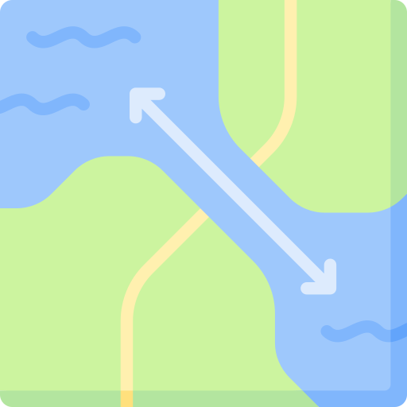

# River Reconditioner

A QGIS plugin to remove artificial obstructions (bridges, weirs, culverts,
embankments) from a DEM along a river line, by replacing cross-sections of
the raster with user-defined shapes and writing a reconditioned GeoTIFF.

Designed for hydraulic modeling workflows where the DEM contains structures
that are not physically part of the riverbed.

---

## Features

- **Longitudinal profile** of the DEM along a selected river line, rendered
  in an interactive matplotlib canvas.
- **N equally-spaced perpendicular cross-sections** along the line
  (default 10, user-configurable), auto-oriented from the local tangent.
- **Two burn workflows:**
  - **Recondition (remove lump)** — cut a straight bed line between two
    anchor stations. Fast, minimal, ideal to delete a bridge or weir.
  - **Burn channel** — assign a shape to each individual cross-section
    (average of neighbours, user-drawn, CSV, or predefined catalogue).
- **Shape catalogue:** rectangular, triangular, trapezoidal, semicircular.
  Each with live preview overlaid on the actual DEM cross-section.
- **Interpolation:** 2D scattered (`scipy.griddata`) or 1D along-line.
- **Feathering:** hard edge or N-meter smoothstep transition inside the
  corridor.
- **Allow raise (build walls)** option: with it off, the tool only cuts
  the terrain (`min(original, new)`); with it on, it can also raise it.
- **Preview mode:** writes to `/vsimem/` without touching disk.
- **Cross-sections export:** the perpendicular lines are written to a
  GeoPackage alongside the output raster.
- Output GeoTIFF preserves the input CRS, geotransform origin, and rotation
  terms. If burn resolution equals the DEM pixel size, the output raster
  is pixel-aligned with the input.

---

## Requirements

- QGIS **3.28** or newer (developed on **3.44**).
- Python packages already shipped with QGIS: `numpy`, `scipy`, `matplotlib`,
  `shapely`, `osgeo.gdal`.
- The river line and the DEM must:
  - be in the **same projected CRS** with **meters** as the unit,
  - not overlap any **NoData** cells,
  - use a **single-feature** line layer per run.

---

## Installation

### Manual (development)

1. Copy the `river_reconditioner/` folder into your QGIS plugin directory:
   - Windows: `%APPDATA%\QGIS\QGIS3\profiles\default\python\plugins\`
   - Linux: `~/.local/share/QGIS/QGIS3/profiles/default/python/plugins/`
   - macOS: `~/Library/Application Support/QGIS/QGIS3/profiles/default/python/plugins/`

2. Restart QGIS.

3. Open *Plugins → Manage and Install Plugins*, search for
   **River Reconditioner**, and enable it.

4. A toolbar button appears. Click it to start.

### Using Plugin Reloader (recommended during development)

Install **Plugin Reloader** from the plugin repository. After editing
files, click its toolbar button and select **River Reconditioner** to
reload without restarting QGIS.

---

## Usage

### 1. Setup

Click the toolbar button. The **Setup** dialog asks for:

- **River line layer** — a single-feature LineString or MultiLineString
  layer, projected CRS in meters.
- **DEM raster** — a single-band GeoTIFF in the same CRS.
- **Number of cross-sections** — default 10, minimum 2.
- **Half-width (each side)** — default 25 m, so the full cross-section
  is 50 m wide.

On OK, the tool:
- Reverses the line if needed so chainage flows from high to low elevation.
- Samples the DEM along the line to build the longitudinal profile.
- Places N perpendicular cross-sections at equal chainage intervals.
- Adds a temporary **River cross-sections** layer to the map.

### 2. Profile

The **Profile** dialog shows chainage (x) vs elevation (y) and the station
markers. From here you can:

- **Recondition (remove lump)** → opens the anchor-based cutter. Pick two
  stations, a width, and an optional extra depth. A straight bed line is
  cut between them. Best for a single bridge or weir.
- **Burn channel…** → opens the per-station shape editor. Assign a mode to
  each cross-section (average, drawn, CSV, catalogue), then burn.
- **Cancel** → closes and removes the temporary cross-section layer.

### 3a. Recondition (remove lump)

- **From station** / **To station** — anchors. Their elevations come from
  the DEM at the line's center.
- **Width of corridor** — full width of the cut.
- **Extra depth below bed** — additional cut below the line joining the
  anchors. Default `0` puts the bed exactly at the anchor elevations.
- **Allow raise** — off by default; turn on to build walls.
- **Feathering** — `Hard edge`, or `Smooth` with an N-meter transition
  applied inside the corridor.
- **Burn resolution** — default = DEM pixel size.
- **Output raster** — default `<dem>_reconditioned.tif`.
- **Preview** — check to write to `/vsimem/` and inspect before
  committing to disk.

### 3b. Burn channel

Assign a **mode** to each station:

- **Average of neighbours** — samples the DEM at chainage ± Δ on either
  side of the station and averages the two slices. Δ is user input,
  default 10 m.
- **Predefined catalogue** — opens the shape dialog: rectangular,
  triangular, trapezoidal, or semicircular. The shape is overlaid on the
  DEM slice at that station so you can adjust parameters visually. Apply
  to one station or to all.
- **User-drawn** — interactive matplotlib canvas (planned).
- **From CSV** — two columns `offset_m,dz_m`, offset 0 at the center,
  `dz = 0` unchanged, negative cuts, positive raises. (Planned.)

Common burn parameters:

- **Interpolation** — `2D (griddata)` for true scattered interpolation
  between stations, or `1D along line` for a swept profile.
- **Feathering** — Hard edge or N-meter smoothstep.
- **Allow raise** — off → `min()`; on → free replacement.
- **Burn resolution** — default = DEM pixel size.
- **Output raster** and **Cross-sections GPKG** paths.
- **Preview** — writes to `/vsimem/`.

---

## Coordinate system and units

All distances and elevations in the tool are in **meters**. The datum for
each cross-section is the **DEM elevation at the line's center** at that
station. Cross-section offsets are signed meters from the centerline; the
vertical axis (dz) is signed meters relative to the datum.

The line layer and DEM must be in the **same projected CRS** with meters
as the map unit. Geographic CRS (degrees) is rejected.

---

## Output

- `*_reconditioned.tif` — Float32 GeoTIFF, LZW compression, tiled.
  Preserves the input CRS, origin, and rotation terms. If burn resolution
  equals the DEM pixel size, the output is pixel-aligned with the input.
- `*_sections.gpkg` (Burn channel workflow only) — the N perpendicular
  cross-section lines with attributes `station`, `chainage_m`, `shape`.

---

## Architecture

